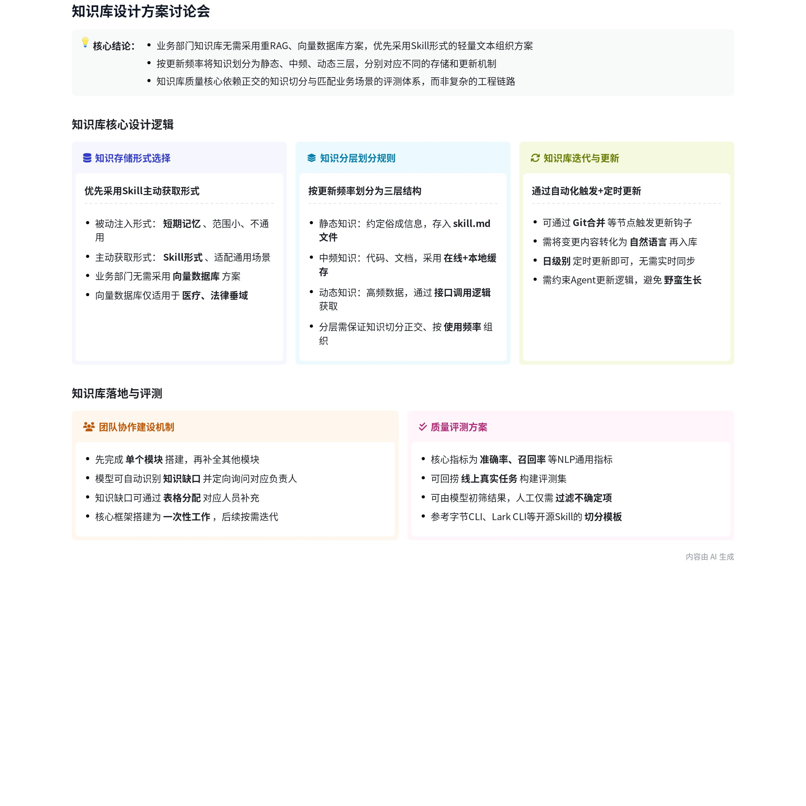
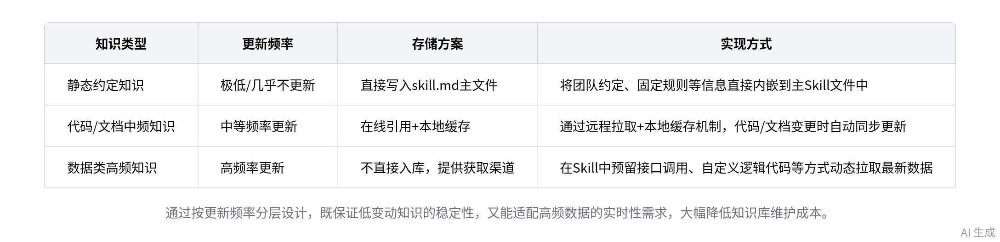
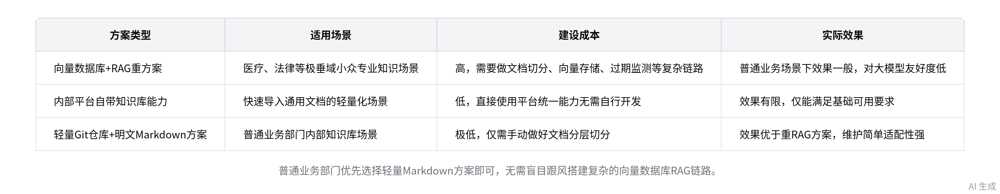
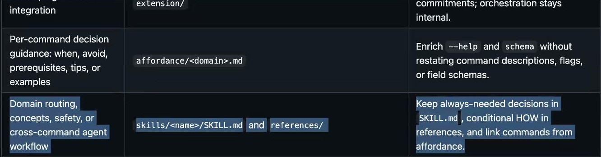

# 知识库设计：会议资料完整整理

## 1. 来源与范围

- 会议主题：知识库设计。
- 会议时间：2026年10月22日（周四）22:31–23:30，GMT+08。
- 参会人：白旭冉、李文豪、林培贤、吕泓瑾、夏文辉、曾宪林。
- 整理日期：2026年10月22日。
- 内容范围：原始智能纪要、会中共享文档、链接的完整文字记录，以及纪要中的3张图片和1张总结画板。
- 整理方式：前半部分按主题汇总，附录保留三份文档全文；文字记录保留发言人、时间戳和原始转写。仅转换格式，未逐句校订转写错误。
- 来源说明：智能纪要和画板由 AI 生成；技术判断为会议中的讨论意见，未在本次整理中另行验证。文字记录中存在识别错误，含义不明确的名称不据此补造。

| 来源 | 文档链接 | 获取版本 |
| --- | --- | --- |
| 智能纪要（用户提供） | [智能纪要：知识库设计](https://bytedance.larkoffice.com/docx/NJ1JdGJaxoo5vjxXtlec2acPnEh) | 5 |
| 会中共享文档 | [知识库设计](https://bytedance.larkoffice.com/docx/VJTZdMJKUo6VN2xA3qVcSWgyn9f) | 363 |
| 完整文字记录 | [文字记录：知识库设计](https://bytedance.larkoffice.com/docx/CwbjdusOAosAtnx3l0gcihAUnZd) | 3 |
| 会议妙记 | [知识库设计](https://bytedance.larkoffice.com/minutes/obcnrvbhmf4t24p2pc1mm2fi?from=ai_minutes) | 保留入口，未下载录音或视频 |

## 2. 背景与总体方向

会议讨论部门知识库如何从0到1建设、如何组织知识、如何随业务更新，以及如何判断质量。白旭冉开场说明，自己没有完整做过此类系统的从0到1项目，本次主要分享理解并共同讨论。

讨论提及 Dycontext、豆包工作、豆包、Codex/Trae 等产品或形态，作为知识如何进入 Agent 上下文的例子。

面向本次讨论中的部门自然语言知识场景，会议建议优先采用 Git 仓库、明文 Markdown、Skill 分层引用和必要的数据获取接口。重点在于知识切分、更新约束和真实业务评测。

## 3. 知识如何进入 Agent

| 方式 | 会中举例 | 讨论中的定位 |
| --- | --- | --- |
| 被动注入 | system/user prompt、类似 `<reminders>` 的标签、本地 memory、项目约定文档 | Agent 启动或执行时由外部机制注入；会议将其概括为较局部、偏短期或项目相关的记忆 |
| 主动获取 | Skill 入口、引用的 Markdown、进一步调用工具 | Agent 根据任务主动获取；会议建议作为跨场景部门知识库的主要组织形式 |

两种形式可以结合：Skill 自身包含静态说明，同时指导 Agent 获取动态信息。Skill 不一定包含代码，例如画图 Skill 可以只按流程图、时序图等用途提供不同提示词。

时间定位：00:03–00:11、00:14–00:20。

## 4. 按更新频率组织知识

| 知识类别 | 典型内容 | 会中建议的载体 | 获取及更新方式 |
| --- | --- | --- | --- |
| 低频或静态知识 | 约定俗成的信息、长期稳定的规则 | Skill 主文件 `skill.md` | 直接写入，变化时维护 |
| 中频知识 | 代码逻辑、文档、系统说明 | Skill 引用的子 Markdown | 在线来源配合本地缓存；无缓存时远程拉取，源代码或文档变化后更新 |
| 高频动态知识 | 数据库中的数据、经常变化的业务信息 | 保留获取方法、接口说明或逻辑代码 | 执行时调用接口或代码获取，不把实时值直接固定在 Skill 中 |

中频层不仅提供知识，也描述如何获取高频层的数据。三类是初步划分，实际系统可以细化为更多层；更新频率决定存储与更新方式，使用频率和业务边界也影响切分。

没有数字化记录、只存在人的经验中的知识，是建设中的难点，需要从相关人员处补充。

时间定位：00:11:37–00:19:43。

## 5. 存储与技术选型

- 轻量方案：Git 仓库加明文 Markdown，按从顶层 Skill 到底层操作说明的方式逐层组织；切分质量影响效果。
- 重型方案：自建数据库、向量化、chunking、检索链路等，会带来存储、文档变更和过期管理成本。
- 会中认为普通业务部门、以自然语言知识为主的场景通常无需从重型 RAG 开始；谈及超大规模知识以及医疗、法律、专业科研等领域时，讨论了可能采用向量数据库的情况。
- Bits、Flux：会中推测其平台知识库可能提供统一的向量存储与导入流程，并建议实测效果。讨论没有给出平台实现证据或效果数据。
- 场景边界：发言中特别区分了内部知识库和 NL2SQL（一句话查数）任务。

纪要中“仅医疗、法律等场景使用向量数据库”等表述属于会中概括，不能据此作为普遍技术结论。

时间定位：00:20:38–00:27:19。

## 6. 内容冷启动与团队协作

1. 先搭建整体框架，完成自己熟悉和负责的模块。
2. 将其他模块及其关联关系补到框架中，明确各模块负责人。
3. 与模型对话补全已有内容，让模型列出知识缺口和需要确认的问题；会中举例提到类似 AskUserQuestion 的交互能力。
4. 将问题整理成表格，由对应负责人补充；负责人无法确认时，进一步寻找能决策的人。
5. 对未记录的业务经验、运营操作、历史服务背景，仍需人工提供信息。模型无法自行恢复已无来源可查的事实。
6. 后续新增知识若持续只通过口头交流，知识缺失会反复发生，需要持续补录。

模块 A/B/C 及负责人关系是会中的协作示例，不是实际任务分工。会议未给出明确的交付负责人或截止日期。

时间定位：00:27:29–00:33:16、00:58:22。

## 7. 更新触发与维护约束

- 为知识标注其依赖来源，形成依赖关系；会中以 DAG 描述这一思路。
- 可在 Git 合并等研发节点接入 hook，触发受影响知识更新。
- 代码或文档变更应在指引下由 LLM 转成自然语言知识，不能任意生成和改写。
- 对会中讨论的更新频率，提出按天定时更新即可的建议；具体节点和周期由业务决定。
- 需要约束 Agent 的更新范围、组织方式和切分粒度。随着内容增加，主动维护和重构，避免自动扩张导致质量下降。
- 白旭冉举例，其所在仓库大约每两周会重构一次知识结构；这是个人实践示例，并非统一维护周期。

时间定位：00:33:16–00:39:53、00:44:54–00:45:36。

## 8. 质量评测与迭代

讨论中的现状：部分团队主要凭主观体验判断知识库质量，尚未建立明确评测机制。

建议的评测路径：

1. 从线上真实任务中回捞数据；没有采集和回捞机制时，需先补齐这一能力。
2. 清洗任务，建立符合实际业务、质量足够高的评测集及 Ground Truth。
3. 对知识或目标对象的召回完整性、命中准确程度进行评测；会中明确提到 Precision、Recall，也提及 Accuracy、TP 等指标。
4. 编码任务可比较应修改的文件名、函数名与标注答案；这是细粒度评测示例。
5. 非编码任务也可以人工标注“是否符合要求”及原因，或使用模型先判断，再由人工筛查不确定项。
6. 用指标发现知识库劣化，并据此维护、调整知识结构和迭代。

会中没有给出具体数据集、指标计算口径、通过阈值或实测分数。转写中的个别指标名称不清晰，未将其整理为已确定指标。

时间定位：00:36:47–00:47:04。

## 9. 参考案例：Lark CLI 与 Byte CLI

会中共享文档列出 Lark CLI 的四层结构：

1. Lark CLI 主体与总入口。
2. `lark-cli <service>` 服务入口。
3. 每个服务模块的具体说明、使用方法与进一步获取内容的方式。
4. 在线数据或数据服务。

讨论还提到模板渲染、标题、service、版本和 Cookbook 式说明，以及按领域或关键词进入相应模块的设计。Byte CLI 被推荐为内部更大范围服务整合的参考。

适用边界：白旭冉同时指出，所展示 CLI 的前几层可能主要随版本发布，最后一层为动态数据，其更新频率与业务代码知识库不同，不能直接认定已有完全相同的在线更新机制。相关开源状态和实现细节按发言保留，未另行核验。

时间定位：00:47:47–00:58:22。

## 10. 后续事项与未确定内容

以下为从讨论中归纳的待明确事项，并非已经分派的会议待办：

| 事项 | 需要明确的内容 |
| --- | --- |
| 范围与切分 | 首批业务模块、层级边界、使用频率、知识依赖 |
| 来源与缺口 | 代码/文档入口、未数字化知识、模块负责人及待确认问题 |
| 更新机制 | 合并或发布节点、hook、缓存、日级任务与生成指引 |
| 评测闭环 | 真实任务回捞、清洗和标注方式、指标口径及维护触发条件 |
| 参考实现 | Lark CLI/Byte CLI 的实际切分方法与模板 |

原文未明确：具体仓库地址、最终目录结构、缓存失效协议、权限设计、实施排期、负责人分工、量化验收阈值。

## 11. 本地图片与总结画板

全部素材已下载，附录 A 中也保留了相应位置。移动文件时应保留同级 `assets/` 目录。

- [三类知识分层存储方案对比](assets/01_三类知识分层存储.png)
- [知识库主流技术方案选型对比](assets/02_技术方案选型.png)
- [成熟 Skill 的分层存储规则示例](assets/03_Skill分层示例.jpg)
- [会议总结画板](assets/04_会议总结画板.jpg)

完整性说明：读取接口返回了一个 `isv` 只读应用块，但未提供其内容，已在附录 A 标记。三份文档的读取响应保存在 `sources/`，以保留版本、结构及引用元数据。未将关联文档中的提及扩展为无限递归抓取。


---

## 附录 A：智能纪要全文

# 智能纪要：知识库设计 2026年10月22日


> 会议主题：知识库设计
> 会议时间：2026年10月22日（周四） 22:31 - 23:30 （GMT+08）
> 参会人：白旭冉、李文豪、林培贤、吕泓瑾、夏文辉、曾宪林


> 智能会议纪要由 AI 生成，可能不准确，请谨慎甄别后使用


# 总结



本次会议围绕部门知识库从0到1的设计方案展开讨论，明确建设路径、技术选型及落地相关问题，内容如下：

- **知识库核心设计逻辑**

  - **知识分类与存储方案**
  
    - 知识划分维度：按更新频率分为静态知识、代码/文档类中频知识、数据类高频知识三类。
    - 静态知识存储：更新极慢的约定类信息直接写入 skill.md 主文件。
    - 中频知识存储：代码、文档通过在线引用+本地缓存实现变更自动更新。
    - 高频知识存储：不直接入库，在 skill 中提供接口调用、逻辑代码等获取方式。
  
    
  - **主流方案对比**
  
    - 被动注入方案：属于短期项目级记忆，不具备全局性，不适用于通用部门知识库。
    - Skill 主动获取方案：为当前通用解决方案，适配跨场景、全局通用的知识库需求。
- **技术选型建议**

  - **向量数据库适用场景**
  
    - 非必要场景：普通业务部门知识库无需使用向量数据库、RAG 重方案，成本高且对大模型不友好。
    - 适用场景：仅医疗、法律等极垂域、小众专业知识场景仍在使用该方案。
  - **现有平台能力评估**：内部 Bits、Flux 等平台自带的知识库能力，本质是统一的向量数据库服务，实际使用效果一般。
  - **推荐落地方案**：采用轻量 Git 仓库+明文 Markdown 文档组织形式，手动做好文档分层切分即可。

  
- **落地与迭代相关问题**

  - **内容建设机制**
  
    - 内容补充：模型会主动向用户询问缺失信息，无需一次性人工补全所有内容。
    - 跨模块协作：先完成自身负责模块的内容搭建，再通过模型识别各模块负责人，定向收集对应知识。
  - **更新触发机制**：可通过 Git 合并等节点加钩子触发更新，配合 LLM 将变更转为自然语言，按天级别更新即可。
  - **质量保障与评测**
  
    - 避免野蛮生长：需对知识库内容切分做正交设计，定期维护知识结构，避免随更新出现劣化。
    - 评测方式：可基于线上真实任务构建评测集，以准确率、召回率为核心指标，辅以模型自动判断+人工过滤异常项。
  - **参考案例**：可参考公司内部开源的 Lark CLI、Byte CLI 等成熟 Skill 的分层切分设计。
  
    

> 原文此处有一个只读应用块，读取接口未提供其正文；保留此位置说明。


# 相关链接

- 会中共享的文档：[知识库设计](https://bytedance.larkoffice.com/docx/VJTZdMJKUo6VN2xA3qVcSWgyn9f)
- 妙记：[知识库设计](https://bytedance.larkoffice.com/minutes/obcnrvbhmf4t24p2pc1mm2fi?from=ai_minutes)
- 文字记录

  - [知识库设计 2026年10月22日](https://bytedance.larkoffice.com/docx/CwbjdusOAosAtnx3l0gcihAUnZd)


---

## 附录 B：会中共享文档全文

# 知识库设计

1. Dycontext
2. 豆包工作
3. 豆包
4. Codex/Trae


知识注入 agent 的形式

1. 主动

Skill 的形式

Lark-draw

1. 流程图：prompt1
2. 时序图：prompt2

1. 被动

```Markdown
system prompt 
use prompt

use prompt 
<reminders></reminders> 

短期记忆

```


---

根据更新频率划分

1. 最快：数据知识
2. 其次：代码逻辑 ｜ 文档信息
3. 一些约定俗成的信息：


1. Skill.md 的信息
2. Sub markdown 的引用内容
3. 通过调用接口获取

   1. 代码获取


静态知识

动态知识


Lark-cli skill 知识切分

四层

1. Lark-cli 主体
2. lark-cli <service> 
3. Lark-cli service 每个模块的具体描述，动态修改获取最底层的内容
4. 在线数据


---

## 附录 C：完整文字记录

# 文字记录：知识库设计 2026年10月22日

> 会议主题：知识库设计  
> 会议时间：2026年10月22日（周四） 22:31 - 23:30 （GMT+08）  
> 智能纪要：[知识库设计 2026年10月22日](https://bytedance.larkoffice.com/docx/NJ1JdGJaxoo5vjxXtlec2acPnEh)


白旭冉、 00:00:18  
这么多人。


白旭冉、 00:00:26  
还有人吗？


白旭冉、 00:00:37  
OK， 好像就6个。稍等啊，我写一个东西。


白旭冉、 00:00:59  
OK， 那我可以就是简单聊一下，因为其实怎么说呢？这个东西其实我也没有做过。就是完全系统的一个设计，就是一个项目，就是一个系统，从0到1。然后但是我大概知道它是一个一怎么回事，然后怎么去做，然后怎么去衡量这个系统，然后怎么去迭代，我大概知道这么回事。但是我没有做过这个，所以的话中间可能有很多问题，然后大家可以直接打断我。对，然后我们来相当于，就是讨论一下这个事情具体怎么做。对。然后就是因为这个的背景是我们要去做一个知识库嘛，然后我们可以首先设想一下，这个知识库应该是一个什么样子的一个形式？像现在的这个就是以公司内的产品为例，公司内可能有很多这个知识库，是第一，我找个飞书文档。


白旭冉、 00:02:19  
就是我找一个空的文档，然后我们来做一个那个什么事，就是目前公司有很多的知识库，其实就是然后就比如的话，那个像我们那个。以抖音内部为例的话，抖音内部最多的可能就是我们内部做的，就是叫 DY context 的一个东西。一般 context。然后除此之外，那个豆包工作。而且豆包本身，它也会含有知识库，就是会有很多我们的一些信息。然后我们再细一点，像一些通用的 agent 其实都有，像 code x。


白旭冉、 00:03:12  
然后像 trae， 其实都有。他们是怎么设计的呢？或者说这个知识应该以一个什么样的形式呈现给那个就是无论是这个 agent 的也好，还是说一个其他的一个，就是 agent workflow 的一个形式也好。这个其实无非就是两种形式，一种是主动灌进去。是，知足知是。


白旭冉、 00:03:47  
一种是主动。十一种是被动。主动的其实比较容易理解，就是可以直接我们举一个例子吧，我们可以去那个 github 上找一个比较那个什么的项目。就是一个 system 吧，就是一个 promote， 我们可以找一个。稍等，我找一个。我开个 VPN， 有点卡。


白旭冉、 00:04:34  
刚出还是卡。


白旭冉、 00:05:05  
稍等啊，我找一个，还没找到。


白旭冉、 00:05:40  
算了算了，我不知道，其实就是第一个，其实很，一种形式就是第一种形式就是那个 agent， 它是主动，它是被动获取的。这种形式其实很简单，就是对于 agent 来说很简单，然后但是它其实是一个比较固定形式的一个。就相当于一个工作流。然后一般的话会在那个就是我们就是常用的这个 agent， 它其实会有很多这个模块，像比较常见的就是可能会分那个 system prompt。还有 user prompt， 这个是第一种。但是其实他这个还是会有细分的，就是像这个 system 可能就不用说，他可能会有一些这个一些约束或者 defender。就是比如 ENV， 一些环境相关的一些信息，就是，比较怎么说呢，比较系统的一些设置，但是 user prompt 里面可能会动态的。就是它因为其实像以 OpenAI 的这个模型为例，它其实 user prompt 其实可以连着很多，就比如它可能第一个 user prompt 里面是一个。就是是一个这个 random， 就是这种一个东西，一个标签，就是使用 XM 的一个形式处理进去。


白旭冉、 00:06:51  
然后这里嘛，其实就是这个具体单词我也不记得了，反正就是这么一个标签会注入进去，然后这个其实就是它的一个知识库。但是这个的话，它其实是那个什么，是那个会通过一些外部的一些工具，然后这些工具就是在这个 agent 启动的时候。然后会把你的这些信息注入进去。很多工具都是有这部分，都是这么做的。就比如你的 Codex， 它会把你的这个 memory 这些东西，是通过一些主动的一个形式注入进去，然后或者你本地的一些 agent 点 MD 这形式注入进去。


白旭冉、 00:07:24  
这个是第一种。这个是一种知识库，这个这种知识库其实是属于比较那个什么的，就是范围比较小的。不太通用的，然后这个可能就是涉及到一些这个一个那些东西就是，这里面可能叫做这个相对来说偏短期记忆。这个是一种，这种其实是非常多，然后那些短期可能还会分超短期、短期，或者说偏中期一点的这种任务。这个其实是比较，这个是一个相对的一个概念。然后一般的话，就是我们个人项目里面，就是它会有本地的这个 memory， 就是你当前项目级别的 I memory。然后整个仓就是你这个电脑用户级别的 memory， 就是这一个配置，还有你这个个人的这个 memory。这几个部分。这个是第一种，就是被动的一个注入，然后另外一种就是 agent 它会去主动获取。他怎么主动获取呢？就是 skill 的这种形式。


白旭冉、 00:08:36  
如果要用，就是大家用那个 skill 特别多的话，其实可以发现，非常多的这个 skill， 它其实是没有任何代码的。就是它只有文本，非常多，然后这些 skill 里面，它其实没有代码，然后只有这个文本，然后这些文本的话，就包括它会拆分成很多细化的一个模块。就比如一个。假设我现在设计一个 skill， 就是一个飞书画图的一个 skill。是那有一个，就是叫做类科。drive 一个一个一个 skill 吧，然后这个 skill 它其实可以完全不用任何的这个代码，它只需要就是有很多这个模块第一。然后就比如画流程图。用什么 prompt？OK OK。


白旭冉、 00:09:39  
嗯？写的这么没有啊？


白旭冉、 00:09:47  
我刚才写进去没了，有点操蛋。啊，刷出来了。对，第一个它可以就是可以有很多。中，对。第一个流程中可能有一个 pro。然后像那个时序图可能又有另外一个 port。


白旭冉、 00:10:18  
这其实也是一，这就是一个 skill， 很多 skill 都是这样设计的，就是而且很多比较知名的 skill 都是这样的。这个其实就是他，这个 agent 主动获取这个知识的，就是一种形式，就是 skill 的一个形式。然后所以我们这里面其实讲的其实是目前其实来分的话，它其实是分两种形式嘛。但是现在的话，其实很多，它是不是把这两种给变成一种了？就是综合起来一种。就是相当于就是我们在这个就是 skill 里面本身会包含一些静态的信息。然后他会去动态地获取一些。这个动态的信息。这个怎么区分呢？就是看你这个信息的更新频率，因为其实刚才在在在群里面有讲，就是我不记得谁问的了，就是当一个，就比如你们现在一个。就是以你们这个部门为例，以一凡他们部门为例，然后你们现在要设计你们整个部门的一个知识库，然后你们的那个就是某一个代码仓库更新的时候。他这个知识库要不要更新？这个其实是一个非常重要的一个问题，这个也就是，这个也是涉及这个就是这个这个知识库，或者说这个东西。


白旭冉、 00:11:37  
的一个核心点。然后这个这些信息就是根据它的更新频率，需要分为两个部分。也不能说分为两个部分，就是可以作为一个筛选吧，就是就是它更新频率。需要根据更新频率来划分。


白旭冉、 00:12:05  
对于更新，就是更新频率比较慢的，或者说根本不更新的，我们把它变成一个静态知识。


白旭冉、 00:12:20  
然后更新频率比较快的，就变成动态知识。对，然后这个概念我们划分之后，其实整个的这个知识库的设计理念其实就有了，但是这里面还需要知道一个点，就是动态知识就是是有哪些呢？其实非常多，就比如怎么说呢？这个应该是，应该可以这样讲，就是因为我理解啊，就是 context is all you need， 就是现在目前来讲。context 就是所有信息。所有这个 agent 东西都都是一个 context， 无论是说一些基本的，就是你对一个代码的这个流程。然后这个代码中涉及到一些数据库，数据库中存到的一些知识，这个本身也是 context。当然它相对于这个代码的流程，它可能说是一个更新比较快的东西，就是数据库里的知识。之后你这个代码的这个里面的这个变化，这个知识。相当于一些潜移默化的知识。他也就是，这是一个，就是主次递进的关系，就比如第一个，一些约定，就是这个更新。频率，然后更新最快的。肯定是一些数据。知识，我们都把它列为知识。然后其次是代码逻辑。然后再最后是一些约定俗成的东西。然后这些信息。这些信息里面可能没有办法在代码中，或者一些文档中，就是有一些具象化的记录。这部分信息是最难拿到的。然后这个中间可能还会有一些其他的信息，就是像一些文档，然后我这边一般会把文档和代码逻辑放在同一个 level 里面。


白旭冉、 00:14:37  
对，所以其实得到，就是我们把这个信息分成这些三类，其实这个知识库的这个设计原型就已经得到了。首先这个知识库里面，就是我们就是像上面来讲，我们说这个知识库一共有两种形式嘛，我们像你们一凡刚才讲，他那种场景肯定是我们没有办法把那个什么。就是做成一个被动的一个形式，因为它要通用嘛，而且被动这种形式其实是非常短期的一个记忆，然后它是项目级别相关的。而且是不具备全局性的，所以肯定没有办法这个直接使用。因为它可能在不同的这个项目里面是不一样的嘛，所以这个我们暂时不考虑，我们肯定是要设计一个 skill 这种形式。就是主动 agent 主动获取的这个知识，这个也是目前的一个就是比较通用的一个解决方案。


白旭冉、 00:15:25  
对，所以可，就是得到的这三部分信息，当然这只是我一个初步划分啊，当然可能就是根据不同的账号，可能就是可以细化为更细的一些内容。就是第一部分肯定是约定俗成的信息，这些信息不会变吗？它是肯定要直接放在那个什么里面的，就是放在这个 skill 本身的，就是这个里面的，就是那个 skill 本身的那个 skill 点 MD 这个文件里面的。


白旭冉、 00:15:49  
第一部分就是 skill 点 mdd 的信息。就是包含一些变化频率特别低的信息。这是第一部分，然后其次第二部分是什么呢？就是有一些相对来说变化频率没有那么快，但是也会变的一些信息。就是代码逻辑和这个就是文档信息。然后这些信息的话，一般是会怎么，就是控呢？它会也是会有那个什么，就是因为一般在 skill 点 MD 里面会以，就是它会有一些这个什么，会有一些引用它的字的 Markdown 文档。这种形式。然后但是呢，因为你这个代码逻辑是有更新的，所以这个 markdown 就是这个那个 server markdown 就是一些子 markdown。肯定是通过一些在线的方式加本地缓存的方式注入进去的。


白旭冉、 00:16:57  
是一般这个有非常多的这个就是案例，本地会有一个点 cache 里面，然后它会就是那个这个 skill 会引用本地的这个就是缓存。然后当缓存没有的，它会去远远程拉取，然后这个远程的信息，当你这个代码变更的时候，或者文档信息变更的时候，它会自动更新。这种形式。


白旭冉、 00:17:28  
然后就是第三种信息，第三种信息就是数据信息，这种信息没有办法就直接回到这个里面，所以它会提供一些什么呢？会提供一些获取方式。


白旭冉、 00:17:51  
通常第三种就是就是这个最更新最快的信息，这部分信息的获取方式是由第二种信息来决定的，就是你可以通过第二部分的这个逻辑。然后来获取到第一部分这个信息。所以其实第二部分就是第三部分，这部分信息肯定是在这个 skill 里面是没有的。但是他可以通过第二个部分，这些渠道来获取获取第一个这个这部分信息的渠道，就比如他会给一些就是最简单的方式。他可能会就是会告诉你应该去调用哪些接口，然后这种形式。


白旭冉、 00:18:38  
然后除此之外。像一些比较复杂的 H， 就是那个 skill， 你需要去那个什么？你需要去给他，就是写一些这个获取的这个逻辑，需要包含代码的，这就是包含代码一些信息，这些代码里面会有这个什么？会有这个就是如何获取这些就是数据支持，这些第一部分就是更新最快的信息。


白旭冉、 00:19:06  
所以其实大部分就是这个知识库的雏形大概就是这样。只不过可能因为一个知识库的这个丰富程度不一样，然后它可能并不一定简简单单地划分为三层。就相当于我们刚才以这个是 lakes job 这个其实形式就是飞书文档的一个形式，其实飞书画图这个形式，其实是展示一下。它可能只有这个两部分，但是其实实际上可能会更复杂。


白旭冉、 00:19:43  
所以一个基本的这个知识库就是这样设计，只不过你需要，就是很清晰地把这三部分给分开，当然实际上，实际情况中可能并不仅仅分这三层。


白旭冉、 00:20:03  
对，基本就这样，没有什么其他的可以，就是细聊的了。


白旭冉、 00:20:24  
我给大家有什么问题吗？没有就结束。


李文豪、 00:20:31  
我我开麦问一个。


曾宪林、 00:20:32  
诶？我有个问题。啊，那个谁？


白旭冉、 00:20:34  
嗯。好。


曾宪林、 00:20:35  
文豪开麦了，是吧？你先问。


李文豪、 00:20:38  
OK， 那我现在也行，就是我有个问题啊，就是因为那个关于那个知识库的呈现形式，我想了解一下，因为你刚才提到了有那什么抖音 context 之类的。因为我看我们这边他有些部门，他们也在做知识库，但有些知识库的呈现形式的话，他们可能涉及得比较重，比如说他们有自己的 DB。可能他们知识入库的时候，还进行了各种 chunking。然后还有各种，对吧？这种可能一些向量数据库，还有各种检索逻辑。但像我们部门有其他同事有有人做的知识库，可能它的呈现形式就是一个 bit 的仓库，然后往里面基本都是这种怎么说。大家能看懂的那种明文吧。一般来说的话，我们搭建这种业务的知识库的话是用哪种方式呢？或者说主流是用哪种呢？


白旭冉、 00:21:28  
就是这个其实就是你问这个问题，就是和你们本身的这个知识的这个密度有关系，就是如果知识不是很大，就是像你们一个业务部门。像就以一凡他们那个部门为例。其实完全没有必要用那些比较复杂的这个外垂 DB， 就是向量数据库，或者一些其他的 DB， 就是这种形式，这这种它虽然提供的是一些结构化的数据。但是其实这些结构化数据对那个什么，对大模型其实是非常不友好的。


李文豪、 00:21:56  
了解。


白旭冉、 00:21:57  
就是，对，而且你们如果要做那个什么，就是像你刚才讲的那样，你要去做那个就是做向量数据库，就相当于传统的这个 rag 这一套吗？然后你们这这个成本非常高，除非你们有非常大量的这个知识，像，就比如以整个抖音为例，他们可能才会这样做，就是你要把整个抖音的这个文档。然后，代码，然后去 chunk， 然后就是切分一下，然后放到这一个 reach db 里面，这个考虑得非常多，你们还，这个同时还需要把这个就是更新。就文档会更新，而且文档会过期。然后就是你要监测它过期了，然后创进去，这种方案其实已经过时了。就是除非对于，而且其实这个一般来说，这个会训在模型里面，本身其实是会有的。


李文豪、 00:22:45  
对，是。


白旭冉、 00:22:51  
然后你们自己去做存储，这个成本非常高，而且效果不一定很好。


李文豪、 00:22:57  
理解，因为其实我看到他们，就是在早些时候是有人这么做的。我看到他们的文档之后，因为他们那个偏工程化设计嘛，确实就是搞了 rag 那一套，感觉非常重。对，诶，我其实还有一个别的问题，就是因为其实我们现在还有很多内部平台嘛，像反正很多，像我们这种我因为我我们生服这边。就他们有类似于诶，或者说大家都知道的，像 bits flux 这种，它这种其实，它天然就提供了知识库的能力，你可以直接把各种乱七八糟文档给它导进去。对，像这种，那这种的话和我们自建的话，就是或者说有什么太大的优势或者区别呢？


白旭冉、 00:23:37  
就是我理解啊，他们这个就是他们给你们提供的，可能也就是像你刚才说的那样，一个 virtual db， 一个一个形式。


李文豪、 00:23:49  
就是怎么说，它是比较统一的一种能力，对吧？


白旭冉、 00:23:53  
对。


李文豪、 00:23:53  
我大概能理解。


白旭冉、 00:23:54  
就是你们可能导导入进去，他们就会走一套流程，然后不是找到你们自己的那个一个租户下的一个，就是一个外存 DB。或者一个其他的一个形式。然后这个可能只是能用而已，具体效果你们可以测一下，应该我理解应该不太好。然后具体就是既然说到这，就可以具体讲一下，就像现在。就是当前这个就是 AI 的这个这个模型的能力，就是以 GPT 6.1，然后还有 Claude 5，这种就是模型的能力。


白旭冉、 00:24:24  
还需要用 VectorDB 的这种就是存储形式，只有可能在就是应用在一种领域，就是他们的那个特别垂域的领域。就比如像医疗。这种领域，或者一些比较顶尖的科研领域，就是这种知识不是通用的知识，就只有极少人才知道。只有这种场景才可能会用那种形式，否则的话几乎没有人用这种就是这种工具来做一些什么东西，就是现在的话在用外存 DB。一般就是比较常用，就两个领域。一个是医疗，还有一个是法律。然后其他的几乎所有领域都不用这个东西，都不用这套方案了。


李文豪、 00:25:06  
明白明白， OK， 其实我们现在做的也就是，其实就搞了一个 Git 的仓库，然后又说，其实就和 AI 各种去对话呀之类的。然后把知识导入进去。当然可能也做了一些冷启的 skill 啊，包括各种这种查知识的 skill， 但始终感觉它不是一个偏工程化的能力。我可能到时候看看吧，我因为这个知识库的质量也不太好评测，我感觉。


白旭冉、 00:25:30  
对，其实我刚才就是群里面，其实一文一凡有聊崩，他是说现在这个东西好不好做？就是这个东西其实并不需，你们可能以为这个东西就是大家会对这个的的认知是需要搞一套非常复杂的工程链路啊。要怎么样用用向量数据库啊，什么这种。乱七八糟，其实根本不需要，你那样做的话，反而效果还没有那么好。


李文豪、 00:25:53  
OK OK， 行，我们现在，哎，还好是一个，反正是一个比较轻的方向吧。OK， 谢谢，我大概就这些问题。


曾宪林、 00:26:03  
行，到我了。刚刚文豪问的问题也是我想问的，第一个就是那个数据的组织形式，可能从我们传统的一些，之前了解到的，刚刚说的那什么 rag 那些向量数据库什么玩意。这些东西。之前好多多少少有听说过，然后刚刚白龙也有聊到说，这个东西的话，组织的形式，我理解下来，你刚刚的核心意思就是让它简单一些嘛。用类似于 Skia MD 的这种东文本的形式来提供就行了，对吧？


白旭冉、 00:26:37  
是的是的，就是对，就是其实这个主要点呢，是在于你们，因为你们是内部是做一些知识库嘛，并不是一些NL2SQL的这种任务。


曾宪林、 00:26:37  
我可以这么理解，可以这么理解吗？


白旭冉、 00:26:51  
就是那个以相当于一句话查数的这种任务。


曾宪林、 00:26:51  
对。


白旭冉、 00:26:56  
所以其实你们的知识的话，就相当于更多是一些偏自然语言的知识吗？其实根本不需要那个什么，就是那个这个就像你说的那样，就是去搞一些那个什么 virtual DB 这种，根本不需要。


曾宪林、 00:27:01  
OK。


白旭冉、 00:27:09  
就是直接使用文档技术就行了，只不过你这个文档要切得比较好才可以，就是你自己要手动切，就是一层一层的从那个顶层的 skill 点 MD 到底层的这些怎么用。


曾宪林、 00:27:19  
对。


白旭冉、 00:27:19  
然后如果你们这个没有办法提供，你们要给他提供，就是一个那个就是他如何获取的这个方式。就可以了。对。


曾宪林、 00:27:29  
现在我有一个问题，就是这样子的，就是比如说我来描述我的一个业务系统的话，我们作为一个研发的目的就是可能在我们这个系统里面运行了很多各种各样的业务。对吧？它不仅有系统设计的知识，也就是说代码的知识。或者说数据库这些这些工程类的知识，对吧？像这些数据库的表结构啊，然后代码怎么流转的，我都可以把代码或者说数据库的表结构这些东西都喂给它，它也能够。


曾宪林、 00:28:00  
解下来，然后也就是说在这个系统之上，所流转的这些业务的知识，它可能分散在各个文档里面，或者说在人的脑袋里面。或者说常规的一些运营的操作，我们可能接触这个系统久了，我知道怎么搞。这些东西很杂，对吧？然后我想问的就是，像这种这么多乱七八糟的东西，是不是也只能靠人力来？把它完善起来，就比如说我今天，我，这是一个长期的建设的过程，我决定了我采用这种形式来组织的话，那么我初期把一些就刚你说的更新频率。快慢的这些东西，比如说代码仓库啊，或者说数据库的设计，这些东西变得不会很快嘛，然后我们就把它维护在里面，然后其余的那些业务领域的知识。我们是不是还是得依靠人的方式去把它，往里填。


白旭冉、 00:28:58  
是这样，但是以，这个肯定就是，因为有很多知识的话，你们既然那个内部里面没有，但是就是肯定需要去一些人力去补充的。但是这个其实补充的话，你可能也不需要像你想那样成本那么高，就是你可以直接用模型，然后把这些给串起来。就是其实有一次性的有一个隐匿的一个过程，就是你先要把这个整个框架搭建起来，然后具体缺哪块知识，模型会问你的。现在的这个模型很智能，它会有一个 askuserquestion 的一个模块，具体有哪些问题，它不懂的时候，或者说逻辑不通的时候。它会问你的。


曾宪林、 00:29:36  
嗯， OK， 然后还有一个问题啊，就是可能啊，像做业务系统的同学都比较清楚的一个是，可能你负责的你们整个团队的业务范围很大嘛。每个人可能负责的系统是其中那么几个，对吧？然后比如说让你来做这个东西的话，是吧？你不可能说把整个团队所有的东西，你都搞得很清楚，对不对？那我们在建设这个的过程中，有没有什么机制来就是能够发挥大家的力量来确认这这个东西到底能不能往我们的这个要建设的东西里面挂。


白旭冉、 00:30:24  
其实很，就是像我刚才讲的，他既然模型能够问你，模型因为其实他很清楚这些东西，他也可以问别人。就是你甚至就是假设的话，我现在是你，我现在可能对于，就是健身，你假设你是负责模块 A， 然后泓瑾负责模块 B， 然后培贤负责这个模块 C。然后就是文豪是 leader， 然后现在咱是是这么一个角色，我要是你，我肯定先把整个 A 的这个模块，就是先给搞定。然后就是和 AI， 就是 chat 完之后，会把这个模块给补全吗？


曾宪林、 00:30:58  
嗯。


白旭冉、 00:30:59  
然后最终我再会去通过我一些引，就是大致的这个记忆，然后把泓瑾的这个模块 B， 还有培贤的这个模块 C， 然后再给写上来。然后之后的话，就是因为其实相当于你们毕竟是一个模块嘛，是一个系统，它肯定是有关联的嘛，它是一个闭环的嘛。


曾宪林、 00:31:16  
嗯。


白旭冉、 00:31:17  
然后模型会知道，就是谁懂哪块，谁懂哪块，然后把这些问，它会，就是需要某一块的知识的时候，你直接让他列出来，然后放到一个表格里面。然后谁来填，然后如果不行的话，就是把这，因为这个问题其实本身是存在的嘛，如果负责人不能确认的话，就找老板嘛。


曾宪林、 00:31:37  
嗯， OK。


曾宪林、 00:31:50  
就是我为什么问这个呢？就是我最近接手了一些历史的一些服务嘛，然后我在接手这个服务，了解这个系统，以及解决这个系统的一些问题的时候。我发现，用这个模型它确实能干，但是有很多东西我感觉它也确认不了，然后我，比如说有同事走了，那个这个东西就无从考证了。我可能就很很难做，然后如果说这个人还在的话，我还能去问他，是吧？让他帮忙决策一下这个东西，是吧？就好做，但是所以说，如果说让你来建设整个团队的知识库的话，那么你就相当于是作为一个你接手了所有团队的，所有模块的这么一个人。就所以你，我觉得在建设知识库的这个过程中，必然会遇到这个问题。


白旭冉、 00:32:45  
对对，因为，但是我理解，其实这个本身的话，就是像健康知识库，它本身是一个一次性的工作，就是至少你做这个是一个一次性的工作。就遇到问题，其实只要抛出来，把它解决了就 OK 了。就是并不会出现一直存在这个问题。当然可能后续你们信息迭代的时候。是也需要注意这个事情的，如果你们后面迭代的信息全部都是，就是口头交流，那没有办法，这个信息就是一直缺失的，就是需要一直补。


曾宪林、 00:33:16  
是。诶，那， OK， 再问一个问题啊，最后一个问题，就是刚刚整个聊的过程中，你说那些组织形式这些我大概明白，然后还有一个就是关于说在迭代的过程中。这个东西怎么更新的？这个厉栋。这一部分我还不是很理解。就是就平时大家可能常规的一个工程研发的工作流就是，我写，把代码写好，端到端验证完，可以上线了，对吧？然后之前有一些文档的信息，可能在技术评审之前就写好了。然后产品需求也评审过了，有这些现有的这些信息。然后我们在一次系统真实上线之后，那么我们这些知识库的信息该在什么节点？由什么东西来触发它更新呢？


白旭冉、 00:34:12  
这个就是需要看你们自己内部的，就是怎么处理的，因为这个其实是不确定的嘛，而且你可以给每一个信息，它会加一些。就是一些一些标签嘛，它依赖哪些信息？然后相当于有一个 dag， 它就是一个有向图，然后当有向图更新的时候，会加一个 hook， 会把这个更新。就可以了。


曾宪林、 00:34:34  
对对，我的意思是，能不能把这个东西做在一些自动化的节点上面？


白旭冉、 00:34:35  
就相当于只是。这肯定是可以的，因为很多都是这么做的。


曾宪林、 00:34:43  
很多人这么做，对吗？


白旭冉、 00:34:44  
对。


曾宪林、 00:34:46  
比如说像 Git 仓库有合并，然后触发一下。


白旭冉、 00:34:52  
是的，但是就是如果有，因为这些信息就是纯文本信息的，它需要那个什么，就是我说的这个可能并不，就是第二部分这些。更多的是需要把它转化成自然语言才行。


曾宪林、 00:35:06  
对，所以说。


白旭冉、 00:35:06  
就是需要 RL。M 把这些转化成自然语言，你需要去，就是给这个 M 做一些。就是一些指引。你并不能拿它随便生成。对，现在一般都是，就是定时更新就可以，因为其实它频率并不是很高，天天级别更新其实就没有问题。而且出问题的话，其实这个不是一个很重大的灾难。


曾宪林、 00:35:41  
这之前，之前在北京的时候，他们也搞过这种东西，就你合了代码之后，或者说怎么样，就自动去更新你的一些 Wiki 之类这些东西。但我没有看到它的效果好在哪里。哈哈哈。


白旭冉、 00:35:57  
因为这个需要去打磨的，就是你这个本身知识库，第一版要做出来的话。


曾宪林、 00:35:59  
对，所以我，对，就是我觉得这个东西的质量啊，还是太依赖人了。就是你如果说让我对我自己做的这个系统，我维护的这些模块，我来搞这么一些东西，我给他弄。就还可能做出来的质量确实会比较高，但是如果说你让我去做一个团队的，是吧？比如说下面是上面提到什么。抖音看。context 这东西，它跨的 scope 太大了，对吧？就很难，不知道怎么，有什么样的机制，或者说怎么样的方式来保证它的值。这个知识库的质量。


白旭冉、 00:36:47  
对，既然你说到这，其实这本质上其实就是一个问题嘛，就是和刚才其实文豪也有提过，就是说如何衡量一个知识库的好坏嘛？如何去 eval， 如何去 jar 吗？这个其实是一个问题，这个首先就是从你这个场景来讲，就是你在更新的时候，就是怎么说呢？因为现在做这些事情嘛。


白旭冉、 00:37:14  
模型这么强，做这个事情其实是一个非常容易的事情。但是把它做好很难。你不要，就是怎么说，你没有任何约束，这个是怎么？就是很早期模型，就是很火的那个概念叫 Harness 嘛，那个 Harness， 早期的那个 Harness 可能就是这个概念。就是你要去约束模型或者 agent 去这些。就是让他生成东西，让他去更新知识库。他去怎么去更改这些内容，你要去约束他，然后并不是让他随心所欲地去改，这个是很重要的，就是，我可以举一个例子吧。我找一个仓库。


曾宪林、 00:37:55  
啊，对啊，既然你提到了约束，那么我们通常怎么约束呢？


白旭冉、 00:38:01  
等我找一个仓库。


白旭冉、 00:38:14  
我这个其实仓库，它其实本身是有一个，就是因为仓库其实本身那个 agent 仓库都是一样的嘛，就是有第一部分。稍等我看。


白旭冉、 00:38:35  
嗯。就是在这个仓库更新的这个过程中，这它会有涉及到很多文档，这个本身其实也是就是一样的一个问题，就是刚才我讲的。这个部分，就是如何切分的问题，就是这些数据如何切分、如何组织的问题，你并不能，怎么说，就是随着时间变长，这个维护成本变高。你只要有，你。就是有，并不一定好。这个屏幕好。


白旭冉、 00:39:05  
对，你看这个是我们这个仓库的切分的一些东西，就是它会切分得很细，这个具体切分你要去控制的，就比如当你意识到一个。就是这个知识量扩的又继续增加的时候，你需要去有意识维护这个仓库才行，并不能就是说 agent， 就是模型生成完之后。你就不管了。好的，那其实本质还是一个问题，就是这个如何优化，你需要需要去有一个对自己知识库的一个比较高质量的一个判断的一个手段。无论是这个 bench， 还是一些其他的指标。当这个指标劣化的时候，你们需要去有意维护，或者说迭代的这个这个知识库才行。如果要是没有任何一个衡量指标，它完全自动化扩张，野蛮生长，那肯定就会越来越差，越来越差。


曾宪林、 00:39:47  
嗯。


白旭冉、 00:39:53  
这个和和代码仓库本身是一个问题。


曾宪林、 00:39:57  
那你有聊到那个 bench， 对吧？评测它，我现在是吧？好像我不知道文豪你们那边啊，是吧？这好像我没见，见到过这种东西，就是关于这个东西的衡量的。好像都是比较主观吧，人觉得它怎么样？或者说我在用用这个东西的时候，感觉它的效果怎么样？是不是就跟我们通经常说啊。Claude 强还是 Codex 强，是吧？


李文豪、 00:40:24  
反正我们这。


曾宪林、 00:40:25  
都主观的东西。


李文豪、 00:40:26  
就纯主观，也没有什么评测机制，大家觉得差不多就行了那种。


曾宪林、 00:40:29  
对。


白旭冉、 00:40:33  
你们这么早才搬的吗？


李文豪、 00:40:36  
是，没什么。


曾宪林、 00:40:37  
对，没有人搞这个。


白旭冉、 00:40:40  
我我我给你。


曾宪林、 00:40:40  
或者大家也不知道怎么搞。


白旭冉、 00:40:43  
我可以给你举个例子，就是因为我这边有很多数据，就是，以 DyConnects 为例吧。首先的话，就是这个最基本的一个评测方式，就是我这边其实只讲评测集嘛，然后可能还有一些线上 Online， 就是线上。就是在线评测的一些方式。然后像他这个评测集肯定就是会把，之前因为其实也在群里面讨论过嘛，就是会把一些线上的流量给复制过来，然后呢就是这些流量是什么？就是用户问一个什么问题，然后这个应该就是用了哪些知识，就是会，是否召回的，然后召回了哪些，召回是否完整，就是有一个召回率。还有那个就是。还有一个什么，就是拒采率，反正有很多这种指标，就是 NLP 的一种指标，因为这是一个比较传统的一个，就是一个 NLP 的一个任务嘛。然后这个就是我们这个任务吧，就是以这个叫 dycontext， 它是这样的，就是它会给定这个一个任务，然后这个任务可能是这个当然是以 SWE 任务为主。就是一个代码任务。然后就是有这个代码任务，然后他们会用 dycontext。是这，或者说叫 DY harness， 加上一些其他的 connect 工具吧，然后去做这个就是知识库的一个是因为这个其实本身就是一个知识库的一个形式嘛。不是，无论是这个 context pro， 还是这个 dev context。然后去让他去找这个就是要修改哪些文件和函数，这是其实一个那个粒度比较细的一个问题，就是一个细度比比较细的一个任务。然后他最终会根据召回的这个文件。具体的文件名，然后还有那个函数名，和 gold truth 来做对比。然后从而获得这个准确率、召回率，这个还有，就是这个叫什么？我。那个指标，我找一下。可以，就是。


曾宪林、 00:42:52  
诶，你刚讲的这些都是一些编码任务，是吗？


白旭冉、 00:42:56  
不一定是编码任务，其实这个指标有很多嘛，像那个正确率。gracey， 还有那个正确的这个识别的准确率，还有 TP， 这个是一个什么词？true positive 就是真阳性，还有这个就是一个 NLP 的一个很，一般其实主要来看这个 precision 还有那个 recall。主要是看这两个。


白旭冉、 00:43:19  
这个对，这个数据一般的话是，就是人工标注的，或者就是从线上起的。你们可能也有一些真实的一些任务，这些任务就是从线上回捞捞过来，但是你其实如果你们要直接用，你们没有一些那个数据回额一些机制。这个数据肯定是捞不回来的，因为你们用的一般都是别人的这个东西。但是这个其实肯定是可以捞回来的，而且这个数据很重要。然后捞回来，然后再做清洗，相当于做一个比较准确的这个就是。叫半企业号吧，还是叫一个，反正它它是一个评测标准。


白旭冉、 00:43:59  
然后最终的这个 Gold Truth， 其实你们可以有一些判断的，就是即使没有这个这么像我们这个 SE 任务为主。就是它没有这个就是这个召回的这个文件名，或者说函数名。但是肯定是有一些其他衡量的标准的。是否符合要求，这个是，其实你们是可以人工标出来的。就是这可能会给，就是或者说让模型来给一个判断，因为现在模型其实很强，你们可以就是给定这个这么一个任务，然后让模型来判断是否符合要求。然后不符合要求为什么？其实是很简单的，就是因为现在都有模型了嘛，那你们可能需要去人工去筛选一些不确定项，过滤掉就可以了。然后相当于有了这个衡量手段之后，然后你们这个 context 或者你们这个知识库是否有劣化，其实就很容易，就是描述出来了。


白旭冉、 00:44:54  
当然这个本身，这个 bench 的质量要非常高才行，要符合真实业务才行，这个线上也是一个很大的一个，就是很难的。而且大部分情况下，其实这个像一个知识库从0到1建设起来，就是它一开始的效果会相对来说是比较好，但是随着知识的更新。它劣化会越来越严重，然后你需要去不断重构它，不断重构它。像我们这个仓库，我们大概可能要，是两周就要重构一次它的这个知识结构。


白旭冉、 00:45:36  
所以本质上最核心的一个问题就是知识如何切分，就是你切分的要足够正交，然后并且，有些知识的获取，它和知识那个就是因为其实本质上有一点信息学。它的那个和这个那个就是哪些信息更容易就是，怎么说呢，使用频率更高。这种形式来做，其实很，相对来说比较容易，只要你有有衡量的指标之后，让模型来做，这其实本质上也是一个 RCA。其实是，因为其实模型最擅长的就是打包。只要我这个衡量之后，效果很好之后，这个其实就是想要迭代非常容易，但是你们需要做的就是能够做出这个衡量这个这个真实业务场景的这个 batch。只要做出来这个之后，这个提升其实是非常容易的，因为其实现在的这个模型，尤其是 dota 模型，最适合做这种 NLP 的这种任务。就是信息拆分的这个任务。


曾宪林、 00:47:04  
泓瑾、培贤怎么不说话？


吕泓瑾、 00:47:09  
我没有问题。


曾宪林、 00:47:13  
讲讲你们怎么做的啊？学习一下。


吕泓瑾、 00:47:17  
我没做啊，我没做知识库啊。


曾宪林、 00:47:20  
你们那边没有实验吗？


吕泓瑾、 00:47:22  
国内没有实现。


曾宪林、 00:47:24  
啊，好吧。


吕泓瑾、 00:47:24  
可能会做一些 harness 相关的，但是其实也就那样吧。


曾宪林、 00:47:34  
感觉好像是，这样好像是不是都在探索？没有太好的时间。


吕泓瑾、 00:47:41  
真的。


曾宪林、 00:47:42  
有没有听说哪个做得很好的呀？


白旭冉、 00:47:47  
你说 Skill 吗？的知识库吗？


曾宪林、 00:47:49  
对啊，公司里面。


白旭冉、 00:47:51  
我刚才其实有讲，其实像类的 CLI， bytedcli 这种都都是做得相对来说比较好的。而且这些其实都是公开的，其实可以看的呀。那我先找一下刚才那个。


白旭冉、 00:48:19  
啊，找那个叫什么 Pro， 对吧？我这个仓库里面应该有的。


白旭冉、 00:48:49  
可以看这个仓库，那咱们公司，刚刚没有搜出来。就是它其中有一个主动的一个。


曾宪林、 00:49:00  
那这东西是杨阳读的吗？


白旭冉、 00:49:03  
嗯，当然了，但是只是我们读不动而已。


曾宪林、 00:49:09  
这是人写的？我不信，靠。


白旭冉、 00:49:14  
这肯定是一版一版迭代的。这个里面肯定是没有的，但是因为这个是最开始的，像这些里面其实都是有，就是会包含一些信息的，这些标签里面。这些就肯定不是。它这个因为是 system pod， 它就给，就是没有的，但是它其实就是都是通过这种标签把信息注入进去的。是我还去想到这个单词。


白旭冉、 00:49:55  
像 Leg C CLI， 其实这些都是，就是你们其实只要参考 skill 的设计就好了。


曾宪林、 00:50:08  
做起来好像确实也是。


白旭冉、 00:50:17  
我我没有啊。还说不要类 CLI。


曾宪林、 00:50:38  
什么玩意？飞书逆向。


吕泓瑾、 00:50:43  
这种是不是在 codebase 上面看一下？


白旭冉、 00:50:44  
不是最近很火的 R R E A 吗？对，其实这个也是一样的，就是，这个反正不重要，就是这个其实本身是个 MCP 嘛。嗯，比较死。不是，它不叫 LexCL， 叫什么？


白旭冉、 00:51:19  
嗯，这个对。从这个就是这个本身，从这个 readme 开始，其实这个他的这个他的这个知识库就开始了。只不过它会切分成很多。嗯，我们可以看一下这个 skill template， 它的这个模板。你看，它这个肯定是整个的，就是它是有很多组件嘛。以我这个。以我这个为例吧，可以看一下我的这个 Codex 里面的。你看这些这么多类的它的 skill， 全部都是这个模板渲染出来的，你看他都可以渲染出来，你们为什么不行？就是一般标准的这个 markdown 都是这样，前面有一个标题，然后有一个 service， 还有个版本号，然后下面就是那个就是相当于一个 Cookbook 的一个形式。好了吧？这个是他们的那个模板，这个是一种，然后这个是什么？我这个可能是主 skill 的这个就是他会把这个功能垂域切分开。


白旭冉、 00:52:34  
第一部分是，就是是一个 service， 然后 service 后面，就是，这相当于我们刚才说的是，这部分只有两层吗？就这有两层嘛，是。它这里面其实是有三层嘛，就是它这里面其实会有一个是。我换个吧，这个 BD。那个 CLI 的这个 skill。这是切分。他其实这样。这样再说起，其实它是有四层的。第一层就是 Lake 主体嘛，本身的这个就是 Lake CLR 的这个主体。第二部分就是它那个子模块的一个主体，就是这个部分。


白旭冉、 00:53:31  
好，第三部分就是它每一个子模块的一些说明东西，就是我们刚才看的这个东西。


白旭冉、 00:53:56  
然后再看一下他这个这个可能就是一些，是他这个渲染的一些配置了吧。


白旭冉、 00:54:09  
对，然后他可能就是这个就是继续细分。这个是权限，就是那个什么的吧？就是一些领域的知识，像比如这个，是相当于一些，就是这个我也没有仔细看过。


曾宪林、 00:54:31  
诶？这个是那个 lark CLI 的。


白旭冉、 00:54:35  
对。


曾宪林、 00:54:35  
知识库啊。


白旭冉、 00:54:37  
就是这个 Skill， 这个 Skill 本身就是一个知识库嘛。反正这是一些，就是相当于一些，就是领域知识，它会就是我理解啊，不一定对，就是当它那个什么的时候，就是当你发送到一个关键词的时候。它会自动切换到这个里面来。


曾宪林、 00:54:56  
诶？


白旭冉、 00:54:56  
然后这个。


曾宪林、 00:54:56  
为啥他会在 GitHub 上有？


白旭冉、 00:54:59  
因为这个是开源的呀。


曾宪林、 00:55:02  
公司开源了。


白旭冉、 00:55:03  
早就开源了。


曾宪林、 00:55:05  
啊，那都不知道。


白旭冉、 00:55:07  
像那个，刚才我们看那个是那个哪，那个任务，就是他肯定是第一部分。第一开始的时候肯定是会把这个部分信息，就是把这个全部的信息都加载进去的。


曾宪林、 00:55:21  
那你这说的还挺对的。能做到人家这种效果也很不错了。


白旭冉、 00:55:27  
对，我刚才，你打断我，我忘了。


曾宪林、 00:55:31  
嗯， sorry。


白旭冉、 00:55:41  
你直接看到这个里面吧。对，你看他其实是有的，他会告诉你怎么用的。其实它这个本身肯定也是 AI 开发的，只要你把那个衡量那个标准给弄出来，这个东西其实非常容易做出来。只是你这个衡阳的这个工具不好做而已。当然你也可以直接就是完全自主开发，然后后面一点点改，这也没有问题。这个看似很难，但是其实现在都完成 AI 驱动了。本质上其实也是一样的嘛。对，这边还有一个，往下第四层就是它的一些数据湖，就是数据服务，这数，在线数据。就是他是通过上面这个。它驱动下一层的吗？


白旭冉、 00:56:58  
他们这边应该就是，他们这边其实应该就是没有我说的这个东西，就是。就是这个在线更新的这个东西，他们其实只是发新版嘛。应该但是飞书应该是支持老版的这个这个接口的，所以就不存在这个问题，而且它这个信息其实变更并不频繁。并不像你们的那个你们那个代码知识里变更那么频繁，所以是他这个就是使用的这种，相当于只有最后一层是动态的。前几层是静态的。


白旭冉、 00:57:38  
OK， 那大概就这样，哥几个还有问题吗？


曾宪林、 00:57:42  
可以学习了，感谢白总。嗯。


白旭冉、 00:57:48  
对，我你们可以去再再再推荐一个，就是你们可以看那个什么，公司内的有一个 byte 那个 CLI， 那个应该比这个大得多。但是我那个好像也是开源的，哦，不是开源的，是公司内可以看的。他会把公司字节云的所有的东西应该都统一到了一起。嗯哼。他们这个 CLSL 我都能看到，


白旭冉、 00:58:22  
这真的假的？是这个吗？啊，不是呀，这也。啊算了，你们后面自己去看吧，但是其实应该都是一样的，只不过它在那个拆分的那个粒度，具体怎么拆的话，就是主要区分就是在这一点。怎么拆？而且对于一凡你们来讲，你们那边最恶心的一个点就是你们一个很多知识。没有做数字化，这就没办法了，就需要这个补一个，也是一个事。对，然后其他的就没有了。OK， 那这样。来吧。
